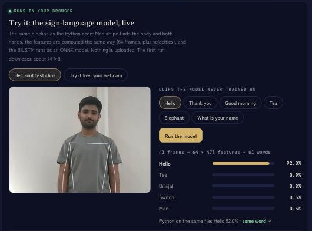

# Ishara: Indian Sign Language Recognition

*Ishara (इशारा) means "sign" or "gesture" in Hindi.*

[](https://github.com/pajiala99/ishara/actions/workflows/ci.yml)

**Live demo: [run the model in your browser](https://pajiala99.github.io/#demo-isl)**, on held-out test clips or your
webcam. MediaPipe's JavaScript tasks track the body and hands, `web/isl.js` computes the same features as
`features.py`, and the BiLSTM runs as ONNX in onnxruntime-web. No video leaves the device. See
[Browser version and parity](#browser-version-and-parity).



*The portfolio demo on a held-out clip: Hello at 92.0%, the same word and probability as the Python pipeline on the same file.*

Word-level ISL recognition from video: MediaPipe skeletal keypoints → signer-invariant
features → BiLSTM with temporal attention → word, text and speech. Runs live on a laptop
webcam; no server, no video leaves the machine.

## Model card

| | |
|---|---|
| **Predicts** | One of 61 Indian Sign Language words, from a short video of a single isolated sign |
| **Model** | BiLSTM (2 layers, 192 units each way) with temporal attention, 1.67M parameters: `models/bilstm_orig.pt`, exported to `models/isl_bilstm.onnx` |
| **Data** | The Kaggle dataset below (MIT): 1,210 original takes of 61 words, all by one signer, one session per word. Split by take, so a take's tilted copies never land on both sides |
| **Input** | MediaPipe pose (9 upper-body points) and both hands on every third frame, normalised to the shoulders, resampled to 64 frames, plus velocities: 64 × 478 |
| **Results** | 182 of 182 held-out takes (99.6% ± 0.5 over three training seeds), which proves little because a Random Forest also scores 100%. The harder protocols: 48.9% from one take per word, 95.6% from five, 25.8% with one hand hidden |

**Limits:** one signer, so nothing here measures accuracy on a new signer, and a webcam user should expect
mistakes; isolated words only; no facial or other non-manual markers; an aid, not an interpreter.
`bilstm_orig.pt`, the model the live demo runs, was trained before the `_mirror` fix (`6cfba6e`); the seed and
protocol numbers come from runs after it.

## Results

Dataset: [Indian Sign Language Video Dataset](https://www.kaggle.com/datasets/prasadshet/indian-sign-language-video-dataset)
(Kaggle, MIT) — 61 word classes, 3,630 clips, 1210 original takes used.

| Model | Test top-1 |
|---|---|
| SVM (RBF) on pooled features | 97.8% |
| Random Forest on pooled features | 100.0% |
| BiLSTM + attention (3 seeds) | 99.6% ± 0.5 |

**The standard split is saturated** — every class was recorded by one signer in a single
~5-minute session, so its 20 takes are near-copies and even a Random Forest hits 100%. A
benchmark every model solves cannot rank models, so the real evaluation is below.

### Data efficiency (takes per class used for training)

| Takes/class | Train clips | Top-1 | Top-5 |
|---|---|---|---|
| 1 | 61 | 48.9% | 79.7% |
| 2 | 122 | 73.6% | 96.2% |
| 3 | 183 | 80.2% | 96.7% |
| 5 | 305 | 95.6% | 99.5% |
| 10 | 606 | 98.9% | 100.0% |
| 14 | 846 | 98.9% | 100.0% |

One example per word already gives 48.9% across 61 classes (chance 1.6%).

### Robustness (same model, perturbed inputs)

| Perturbation | Top-1 |
|---|---|
| clean | 98.9% |
| mirror | 95.6% |
| rotate 15 | 98.4% |
| scale 20 | 98.4% |
| shift 10 | 98.9% |
| speed 50 | 98.4% |
| frame drop 30 | 96.7% |
| noise 03 | 98.9% |
| occlude left hand | 25.8% |

Off-centring and landmark noise cost nothing, and rotation, scale and speed changes cost one
clip of 182 each, so geometry and tempo are almost fully absorbed by the normalisation. A
mirrored signer costs 3.3 points. Occluding one hand collapses accuracy, which is correct —
many ISL signs are two-handed.

### Augmentation ablation (2 takes/class, mean of 2 seeds)

| Setting | Top-1 |
|---|---|
| none | 83.2% |
| full | 75.5% |
| no mirror | 86.0% |
| geometric only | 86.5% |
| mirror only | 74.7% |

Mirroring *hurts* on a single-signer dataset: mirrored clips are inputs the test distribution
never contains, and many ISL signs are not left-right symmetric. Geometric jitter and noise
help. An augmentation is only valid if it imitates variation that exists in deployment.

The BiLSTM numbers above were regenerated on 5 Nov 2026 after a bug fix: `_mirror` used to
swap the two hands but not the pose's arms and hips, so a mirrored clip put each wrist on the
opposite side from its hand. Every run that never mirrors reproduced its old number exactly.
The fixed mirror still costs 10.4 points (86.0% → 75.5%; it was 12.1 before), so the
conclusion never depended on the bug. `models/bilstm_orig.pt` was trained before the fix and
is unchanged.

## See it working

Three recordings in [`media/`](media/) — all H.264, so they play in the browser.

| Video | What it shows |
|---|---|
| [`model_demo.mp4`](media/model_demo.mp4) | The trained model classifying six held-out clips it never saw, with its top-5 and confidence drawn on each frame |
| [`preprocessing_demo.mp4`](media/preprocessing_demo.mp4) | The preprocessing pipeline running frame by frame: raw video with landmarks, the normalised skeleton, the feature matrix building up, and live numbers |
| [`invariance_demo.mp4`](media/invariance_demo.mp4) | The same clip through two different "cameras" — one zoomed and shifted — producing near-identical normalised skeletons (mean abs. difference 0.011) |

Run them yourself:

```bash
export PYTHONPATH=$PWD/src
python -m isl.demo --random 6 --play --speak     # the model, on held-out clips
python -m isl.visualize --word Tea               # the preprocessing, four panels
python -m isl.visualize --word Tea --invariance  # the normalisation, proved
```

`--save out.mp4` records any of them. `isl.visualize --figure stages.png` writes a single
still, which is where [`artifacts/preprocessing_stages.png`](artifacts/preprocessing_stages.png)
and [`artifacts/invariance_proof.png`](artifacts/invariance_proof.png) came from.

The clips are from the source dataset, which is MIT-licensed and published publicly.

## Pipeline

```
video.mp4 → frame sampling (every 3rd) → MediaPipe pose + 2 hands
         → body-frame normalisation → 64-frame resample → +velocity
         → 64 × 478 tensor → BiLSTM + attention → word
```

Per frame, 239 features: 9 upper-body pose points (x, y, visibility), both hands
body-relative (x, y), both hands wrist-local (x, y, z), 2 presence flags; plus frame-to-frame
deltas → 478. The rationale for each step is in `CROSS_QUESTIONS.md`.

## Layout

```
src/isl/
  config.py          paths, feature layout, hyper-parameters
  keypoints.py       MediaPipe Tasks wrapper (hand + pose landmarkers)
  extract.py         stage 1: videos → cached .npz landmarks (multi-process)
  features.py        normalisation, resampling, deltas, pooled stats
  dataset.py         group-aware stratified split, torch Dataset, augmentation
  models.py          BiLSTM+attention, Transformer encoder
  train.py           stage 2: training loop (MPS/CUDA/CPU)
  baselines.py       SVM / Random Forest on pooled features
  evaluate.py        stage 3: metrics, confusion matrix, curves
  experiments.py     data efficiency, robustness, augmentation protocols
  ablation.py        which augmentations help; seed variance
  error_analysis.py  confusions in the regime where the model errs
  plots.py           figures used in the slides
  speech.py          text-to-speech: Indian-English voice, queued, de-duplicated
  demo.py            predict held-out clips (optionally play them, optionally speak)
  record.py          record your own clips for an unseen-signer test
  unseen_signer.py   score the model on a signer it has never seen
  realtime.py        webcam demo: live text + speech, sentence buffer
  visualize.py       four-panel preprocessing visualiser and the invariance demo
```

## Running it

```bash
pip install -r requirements.txt
export PYTHONPATH=$PWD/src

# 1. data: download + unzip the Kaggle dataset into data/videos/
# 2. landmarks (~7 min for 1,210 clips on 6 workers)
python -m isl.extract --videos data/videos/Video_Dataset/Video_Dataset \
                      --out data/keypoints --stride 3 --workers 6 --exclude "_tilt"
# 3. train + evaluate
python -m isl.train --model bilstm
python -m isl.baselines
python -m isl.evaluate --ckpt models/bilstm.pt
# 4. the protocols that actually measure generalisation
python -m isl.experiments
python -m isl.ablation
python -m isl.error_analysis
python -m isl.plots
# 5. check it yourself on held-out clips (add --play to watch, --speak to hear)
python -m isl.demo --random 15 --play --speak

# 6. live demo: text on screen + spoken output
python -m isl.realtime --ckpt models/bilstm_orig.pt --speak
```

## Tests

```bash
pip install pytest
pytest
```

14 tests run in seconds on synthetic landmarks, with no dataset or camera: the feature
layout and its invariance to where the signer stands and how far away, the group-aware
split (no take's tilt variants on both sides), mirroring (hands and arms swap together)
and augmentation, both encoders,
and that `models/bilstm_orig.pt` still loads into the current code with the 61 classes in
`artifacts/classes.json`. CI runs them on every push to `main`. Not covered: landmark
extraction from video (needs the Kaggle dataset) and the live demo (needs a webcam).

## Browser version and parity

The [live demo](https://pajiala99.github.io/#demo-isl) runs this pipeline in the browser. `web/isl.js` uses MediaPipe
Tasks JS 1.1.0, the same release as the Python `mediapipe` 1.1.0, with the same `.task` model files. It ports
`features.py` line for line and runs the BiLSTM exported by `python -m isl.export_onnx` in onnxruntime-web. Three
checks, from the inside out:

| Check | Compared | Result |
|---|---|---|
| Export | PyTorch vs ONNX, on the features of the 182 held-out takes | Same top word on 182 of 182; largest probability difference 4.8 × 10⁻⁷ |
| Features | `isl.js` vs `features.py`, on the cached keypoints of all 1,210 takes | Bit-identical: all 37,016,320 values |
| End to end | The same 182 held-out clips through MediaPipe Python + numpy + PyTorch, and through MediaPipe JS + `isl.js` + onnxruntime-web in Chromium 152 | Same top word on 181 of 182 (the browser is right on all 182, Python on 181). Same frames sampled on all 182; median largest probability difference 0.0009; landmarks a median 0.005 of the frame apart |

Two details made the features bit-identical. numpy rounds every float32 operation, so `isl.js` rounds with
`Math.fround` after each one. On Apple Silicon, numpy's `np.interp` computes `slope * dx + y` as one fused
multiply-add, which `isl.js` emulates exactly. The dataset's videos are MPEG-4 Part 2, which browsers can't decode, so
both sides read the same H.264 copies made with macOS `avconvert`.

The one disagreement is the least confident clip in the test set (`Radish/WIN_20231102_12_30_22_Pro`), a near-tie:
Python says *cry* 36.5% over *radish* 31.8%, the browser *radish* 34.5% over *cry* 33.9%. Converting that clip to
H.264 already flips Python's own answer (*radish* 41.6% on the original file); on the other 181 clips the copy and the
original give Python the same word. The residual landmark differences come from the two MediaPipe builds and video
decoders, not from the feature code, which check 2 shows is exact. Results are in
`artifacts/onnx_export.json`, `artifacts/feature_parity.json` and `artifacts/parity.json`.

```bash
python -m isl.export_onnx                                   # 1. needs onnx + onnxruntime (best in their own env)
python -m isl.parity features && node web/check_features.mjs     # 2.
python -m isl.parity clips      # 3. H.264 copies of the held-out clips, and Python's answer for each
python -m isl.parity serve      #    then open http://127.0.0.1:8765/web/parity.html and let it finish
python -m isl.parity compare
```

## Text and speech output

A prediction becomes a spoken word only after three filters: softmax confidence ≥ 0.60,
the same word predicted on 2 consecutive windows, and not identical to the previous word.
Without them the model — which re-predicts every 5 frames — would speak one sign a dozen
times and read every transition between signs aloud.

The window shows a mirror image, like a selfie, but landmarks are read from the frame as the camera
filmed it: the dataset was filmed that way, and `record.py` saves takes the same way. Mirroring the
frame before reading it, as the live demo first did, costs the shipped model 15 of the 182
held-out takes (167/182 on mirrored input).

Confirmed words accumulate into a sentence shown at the bottom of the window:
`space` speaks the whole sentence, `c` clears it, `m` mutes, `q` quits.

`speech.py` tries macOS `say` (preferring an Indian-English voice such as Aman, Rishi or
Veena), then pyttsx3, then a printing fallback, and speaks on a worker thread with a 1.2 s
repeat guard so recognition never blocks on the voice.

Trained on Apple Silicon GPU via PyTorch MPS; training itself takes 2.2 minutes.

## Known limitations

- Isolated words only — no continuous sentence recognition.
- Single-signer dataset, so signer-independent evaluation is impossible here; cross-dataset
  testing on INCLUDE (263 signs, multiple signers) is the next step.
- No facial / non-manual markers yet.
- An assistive aid, not a replacement for a human interpreter.

## Rebuilding the slides

The deck is generated from `artifacts/` — see [tools/README.md](tools/README.md).
To add the unseen-signer slide: `python -m isl.record` then `python -m isl.unseen_signer`.

---

**Hardik Pajiala** · [LinkedIn](https://linkedin.com/in/hardik-pajiala) · [Portfolio](https://pajiala99.github.io) · [GitHub](https://github.com/pajiala99)
