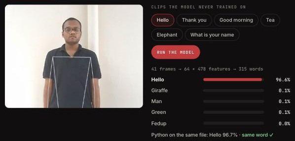
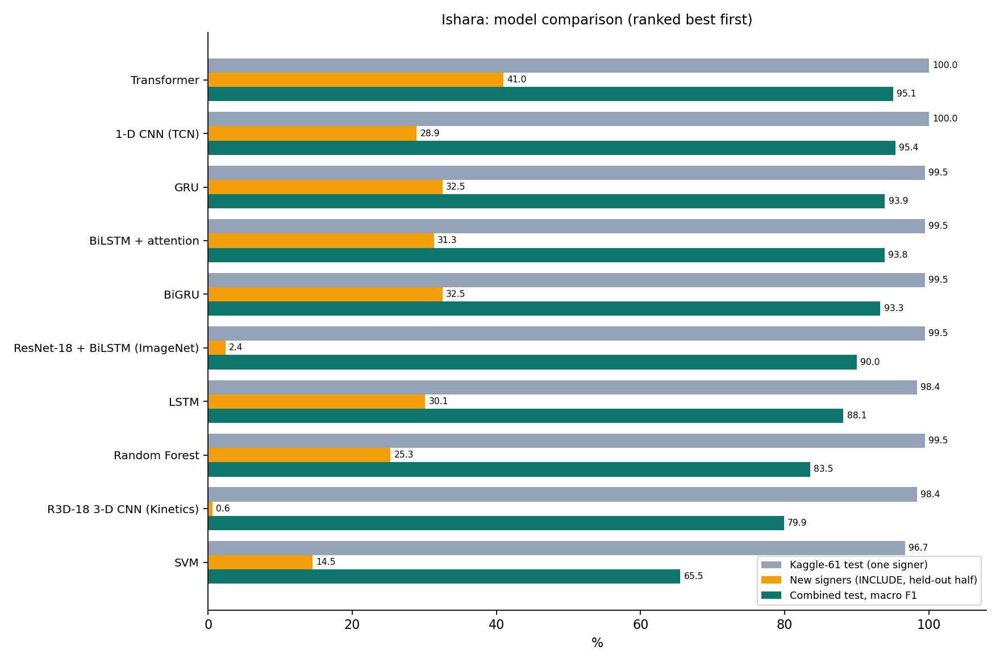

# Ishara: Indian Sign Language Recognition

*Ishara (इशारा) means "sign" or "gesture" in Hindi.*

[](https://github.com/pajiala99/ishara/actions/workflows/ci.yml)

**Live demo: [run the model in your browser](https://pajiala99.github.io/#demo-isl)**, on held-out test clips or your
webcam. MediaPipe's JavaScript tasks track the body and hands, `web/isl.js` computes the same features as
`features.py`, and the 315-word Transformer runs as ONNX in onnxruntime-web. No video leaves the device. See
[Browser version and parity](#browser-version-and-parity).



*The portfolio demo on a held-out clip: the 315-word Transformer gives Hello 96.6% in the browser and 96.7% in Python on the same file.*

Word-level ISL recognition from video: MediaPipe skeletal keypoints → signer-invariant
features → Transformer encoder with attention pooling → word, text and speech. Runs live on a laptop
webcam; no server, no video leaves the machine.

## Model card

| | |
|---|---|
| **Predicts** | One of 315 Indian Sign Language words, from a short video of a single isolated sign |
| **Model** | Transformer encoder (3 layers, 4 heads) with attention pooling, 1.52M parameters: `models/isl_transformer.pt`, exported to `models/isl_transformer.onnx`. Chosen from ten models, see [Model comparison](#model-comparison-on-315-words-and-new-signers) |
| **Data** | The Kaggle dataset below (MIT; 61 words, one signer) and INCLUDE (AI4Bharat; 263 words, several signers): 5,494 clips. Split by take, so a take's tilted copies never land on both sides; the split is `artifacts/split_combined.json` |
| **Input** | MediaPipe pose (9 upper-body points) and both hands, x in frame-height units (the aspect fix), normalised to the shoulders, resampled to 64 frames, plus velocities: 64 × 478 |
| **Results** | 95.8% top-1, 98.8% top-5 and 95.1 macro F1 on 801 held-out clips; 0.8 ms per clip on a CPU |

**Limits:** each word was learned from one signer (Kaggle) or a few (INCLUDE), so accuracy is lower on new people:
the same Transformer trained on the Kaggle signer alone got 41% top-1 on INCLUDE signers, and a webcam user should
expect mistakes. Isolated words only; no facial or other non-manual markers; an aid, not an
interpreter. The original 61-word BiLSTM (`models/bilstm_orig.pt`, `models/isl_bilstm.onnx`) is kept, and every
script takes it with `--ckpt`; the Kaggle-only protocols below (data efficiency, robustness, augmentation) were run
with it.

## Model comparison on 315 words and new signers

Ten models, one split, one set of metrics, so the choice rests on evidence. The Kaggle data was joined with
[INCLUDE](https://zenodo.org/records/4010759) (AI4Bharat: 263 words, 4,284 videos, several signers; 9 words are in both): **315 words,
5,494 clips**, split by take as before (5,532 training clips including 1,640 tilted copies, 801 validation, 801 test).
Every network gets the same optimiser, schedule, early stopping and augmentation (`src/isl/compare.py`); the two
pretrained models are frozen backbones on video frames with a trained head (`src/isl/pixel.py`).

| Rank | Model | Type | Top-1 | Top-5 | Precision | Recall | Macro F1 | New signers top-1 / top-5 | Params | ms per clip |
|---|---|---|---|---|---|---|---|---|---|---|
| 1 | **Transformer** | keypoints | **95.8** | 98.8 | 95.7 | 95.5 | 95.1 | **41.0** / 71.1 | 1.52 M | 0.8 |
| 2 | 1-D CNN (TCN) | keypoints | 95.8 | 98.8 | 96.6 | 95.7 | 95.4 | 28.9 / 57.8 | 0.91 M | 0.7 |
| 3 | GRU | keypoints | 94.4 | 98.4 | 94.9 | 94.6 | 93.9 | 32.5 / 61.4 | 0.62 M | 1.4 |
| 4 | BiLSTM + attention | keypoints | 94.8 | 98.3 | 94.7 | 94.4 | 93.8 | 31.3 / 50.6 | 1.77 M | 3.0 |
| 5 | BiGRU | keypoints | 94.3 | 98.1 | 94.1 | 94.0 | 93.3 | 32.5 / 59.0 | 1.40 M | 2.9 |
| 6 | ResNet-18 (ImageNet) + BiLSTM | pretrained, pixels | 90.4 | 96.8 | 91.4 | 91.0 | 90.0 | 2.4 / 10.8 * | 0.77 M | 236 |
| 7 | LSTM | keypoints | 90.3 | 97.9 | 89.4 | 89.2 | 88.1 | 30.1 / 47.0 | 0.77 M | 1.6 |
| 8 | Random Forest | classical | 85.4 | 96.1 | 85.2 | 85.3 | 83.5 | 25.3 / 65.1 | | 13.2 |
| 9 | R3D-18 (Kinetics-400) 3-D CNN | pretrained, pixels | 80.0 | 93.9 | 82.7 | 81.2 | 79.9 | 0.6 / 11.4 * | 0.16 M | 219 |
| 10 | SVM | classical | 66.9 | 82.0 | 69.7 | 66.5 | 65.5 | 14.5 / 49.4 | | 3.7 |

Top-1 to F1: the combined test set (801 clips; macro scores weight every word equally). **New signers:** the same
model trained on the Kaggle signer alone, scored on INCLUDE clips of the 9 words both datasets share, signed by
other people (61-way choice, chance 1.6%). Those 167 clips are split in half: one half chose the feature settings,
the other half (83 clips) is reported here. \* The pixel models use no keypoints: their figure is from all 167
clips. Latency: one clip on a CPU for keypoint models; pixel models include their backbone on the Mac GPU. Trainable
parameters for the pixel models. Full table: [`artifacts/model_comparison.md`](artifacts/model_comparison.md).



**Choice: the Transformer.** The rule is macro F1 on the combined test, with models within one point of the best
counted as tied (one point is about 8 test clips), and ties going to new-signer accuracy. The Transformer and the
1-D CNN tie on the combined test (95.8% top-1 each, F1 95.1 and 95.4), and on signers neither has seen the
Transformer is clearly ahead (41.0% against 28.9%). It is also 0.8 ms per clip, fast enough for live use.

What the comparison showed:

- **The one-signer test cannot choose a model:** all ten score 96.7–100% on it.
- **Pretrained pixel models transfer worst.** ImageNet and Kinetics features are 90.4% and 80.0% on the combined
  test but at chance on new signers: they learn the look of one person and room, not the movement. Keypoints carry
  the sign and drop the background, and are about 300 times faster.
- **A bug found by the new-signer test.** MediaPipe gives x in frame widths and y in frame heights. Kaggle videos
  are 640–880 × 720 and INCLUDE 1920 × 1080, so INCLUDE bodies came out squashed sideways. Putting x in
  frame-height units (`features.py`, `aspect`) lifted new-signer top-1 for every model that was measured both
  ways (BiLSTM 15.7 → 31.3, LSTM 24.1 → 30.1, GRU 24.1 → 32.5 on the reported half). Trimming idle frames and
  mirroring did not help on the dev half and are off.

Rebuild: `python tools/download_include.py`, `python -m isl.extract` on `data/include/videos`, then
`tools/final_pipeline.sh` runs the comparison, the pixel models, the table and the dashboard. Results are in
[`dashboard/index.html`](dashboard/index.html) (offline, one file) and `streamlit run dashboard/app.py` (live).

## Results

Dataset: [Indian Sign Language Video Dataset](https://www.kaggle.com/datasets/prasadshet/indian-sign-language-video-dataset)
(Kaggle, MIT) — 61 word classes, 3,630 clips, 1210 original takes used.

| Model | Test top-1 |
|---|---|
| SVM (RBF) on pooled features | 97.8% |
| Random Forest on pooled features | 100.0% |
| BiLSTM + attention (3 seeds) | 99.6% ± 0.5 |

**The standard split is saturated** — every class was recorded by one signer in a single
~5-minute session, so its 20 takes are near-copies and even a Random Forest hits 100%. A
benchmark every model solves cannot rank models, so the real evaluation is below.

### Data efficiency (takes per class used for training)

| Takes/class | Train clips | Top-1 | Top-5 |
|---|---|---|---|
| 1 | 61 | 48.9% | 79.7% |
| 2 | 122 | 73.6% | 96.2% |
| 3 | 183 | 80.2% | 96.7% |
| 5 | 305 | 95.6% | 99.5% |
| 10 | 606 | 98.9% | 100.0% |
| 14 | 846 | 98.9% | 100.0% |

One example per word already gives 48.9% across 61 classes (chance 1.6%).

### Robustness (same model, perturbed inputs)

| Perturbation | Top-1 |
|---|---|
| clean | 98.9% |
| mirror | 95.6% |
| rotate 15 | 98.4% |
| scale 20 | 98.4% |
| shift 10 | 98.9% |
| speed 50 | 98.4% |
| frame drop 30 | 96.7% |
| noise 03 | 98.9% |
| occlude left hand | 25.8% |

Off-centring and landmark noise cost nothing, and rotation, scale and speed changes cost one
clip of 182 each, so geometry and tempo are almost fully absorbed by the normalisation. A
mirrored signer costs 3.3 points. Occluding one hand collapses accuracy, which is correct —
many ISL signs are two-handed.

### Augmentation ablation (2 takes/class, mean of 2 seeds)

| Setting | Top-1 |
|---|---|
| none | 83.2% |
| full | 75.5% |
| no mirror | 86.0% |
| geometric only | 86.5% |
| mirror only | 74.7% |

Mirroring *hurts* on a single-signer dataset: mirrored clips are inputs the test distribution
never contains, and many ISL signs are not left-right symmetric. Geometric jitter and noise
help. An augmentation is only valid if it imitates variation that exists in deployment.

The BiLSTM numbers above were regenerated on 5 Nov 2026 after a bug fix: `_mirror` used to
swap the two hands but not the pose's arms and hips, so a mirrored clip put each wrist on the
opposite side from its hand. Every run that never mirrors reproduced its old number exactly.
The fixed mirror still costs 10.4 points (86.0% → 75.5%; it was 12.1 before), so the
conclusion never depended on the bug. `models/bilstm_orig.pt` was trained before the fix and
is unchanged.

## See it working

Three recordings in [`media/`](media/) — all H.264, so they play in the browser.

| Video | What it shows |
|---|---|
| [`model_demo.mp4`](media/model_demo.mp4) | The trained model classifying six held-out clips it never saw, with its top-5 and confidence drawn on each frame |
| [`preprocessing_demo.mp4`](media/preprocessing_demo.mp4) | The preprocessing pipeline running frame by frame: raw video with landmarks, the normalised skeleton, the feature matrix building up, and live numbers |
| [`invariance_demo.mp4`](media/invariance_demo.mp4) | The same clip through two different "cameras" — one zoomed and shifted — producing near-identical normalised skeletons (mean abs. difference 0.011) |

Run them yourself:

```bash
export PYTHONPATH=$PWD/src
python -m isl.demo --random 6 --play --speak     # the model, on held-out clips
python -m isl.visualize --word Tea               # the preprocessing, four panels
python -m isl.visualize --word Tea --invariance  # the normalisation, proved
```

`--save out.mp4` records any of them. `isl.visualize --figure stages.png` writes a single
still, which is where [`artifacts/preprocessing_stages.png`](artifacts/preprocessing_stages.png)
and [`artifacts/invariance_proof.png`](artifacts/invariance_proof.png) came from.

The clips are from the source dataset, which is MIT-licensed and published publicly.

## Pipeline

```
video.mp4 → frame sampling (every 3rd) → MediaPipe pose + 2 hands
         → body-frame normalisation → 64-frame resample → +velocity
         → 64 × 478 tensor → Transformer + attention pooling → word
```

Per frame, 239 features: 9 upper-body pose points (x, y, visibility), both hands
body-relative (x, y), both hands wrist-local (x, y, z), 2 presence flags; plus frame-to-frame
deltas → 478. The rationale for each step is in `CROSS_QUESTIONS.md`.

## Layout

```
src/isl/
  config.py          paths, feature layout, hyper-parameters
  keypoints.py       MediaPipe Tasks wrapper (hand + pose landmarkers)
  extract.py         stage 1: videos → cached .npz landmarks (multi-process)
  features.py        normalisation, resampling, deltas, pooled stats
  dataset.py         group-aware stratified split, torch Dataset, augmentation
  models.py          BiLSTM+attention, LSTM / GRU / BiGRU, 1-D CNN (TCN), Transformer encoder
  train.py           stage 2: training loop (MPS/CUDA/CPU)
  baselines.py       SVM / Random Forest on pooled features
  compare.py         every model on one split: test metrics, latency, new-signer scores
  pixel.py           pretrained ResNet-18 and R3D-18 on video frames, frozen, with a trained head
  compare_report.py  ranks the models and writes the comparison table and chart
  dashboard.py       the offline results page, dashboard/index.html
  evaluate.py        stage 3: metrics, confusion matrix, curves
  experiments.py     data efficiency, robustness, augmentation protocols
  ablation.py        which augmentations help; seed variance
  error_analysis.py  confusions in the regime where the model errs
  plots.py           figures used in the slides
  speech.py          text-to-speech: Indian-English voice, queued, de-duplicated
  demo.py            predict held-out clips (optionally play them, optionally speak)
  record.py          record your own clips for an unseen-signer test
  unseen_signer.py   score the model on a signer it has never seen
  realtime.py        webcam demo: live text + speech, sentence buffer
  visualize.py       four-panel preprocessing visualiser and the invariance demo
```

## Running it

```bash
pip install -r requirements.txt
export PYTHONPATH=$PWD/src

# 1. data: download + unzip the Kaggle dataset into data/videos/
# 2. landmarks (~7 min for 1,210 clips on 6 workers)
python -m isl.extract --videos data/videos/Video_Dataset/Video_Dataset \
                      --out data/keypoints --stride 3 --workers 6 --exclude "_tilt"
# 3. train + evaluate
python -m isl.train --model bilstm
python -m isl.baselines
python -m isl.evaluate --ckpt models/bilstm.pt
# 4. the protocols that actually measure generalisation
python -m isl.experiments
python -m isl.ablation
python -m isl.error_analysis
python -m isl.plots
# 5. check it yourself on held-out clips (add --play to watch, --speak to hear)
python -m isl.demo --random 15 --play --speak

# 6. live demo: text on screen + spoken output
python -m isl.realtime --speak                     # the 315-word Transformer; --ckpt models/bilstm_orig.pt for the 61-word BiLSTM
```

## Tests

```bash
pip install pytest
pytest
```

14 tests run in seconds on synthetic landmarks, with no dataset or camera: the feature
layout and its invariance to where the signer stands and how far away, the group-aware
split (no take's tilt variants on both sides), mirroring (hands and arms swap together)
and augmentation, both encoders,
and that `models/bilstm_orig.pt` still loads into the current code with the 61 classes in
`artifacts/classes.json`. CI runs them on every push to `main`. Not covered: landmark
extraction from video (needs the Kaggle dataset) and the live demo (needs a webcam).

## Browser version and parity

The [live demo](https://pajiala99.github.io/#demo-isl) runs this pipeline in the browser. `web/isl.js` uses MediaPipe
Tasks JS 1.1.0, the same release as the Python `mediapipe` 1.1.0, with the same `.task` model files. It ports
`features.py` line for line, including the aspect fix (it takes the video's or webcam's own width / height), and runs
the 315-word Transformer exported by `python -m isl.export_onnx` in onnxruntime-web. `models/isl_meta.json` names the
model file and says whether it needs the aspect fix, so the page follows whichever model was exported. Three checks,
from the inside out:

| Check | Compared | Result |
|---|---|---|
| Export | PyTorch vs ONNX, on the features of the 801 held-out clips | Same top word on 801 of 801; largest probability difference 6.6 × 10⁻⁷; 95.8% top-1 in both |
| Features | `isl.js` vs `features.py` with the aspect fix, on the cached keypoints of all 1,210 Kaggle takes and every 4th INCLUDE clip (2,281 clips) | Bit-identical: all 69,780,352 values. Without the aspect fix (the 61-word BiLSTM's features), all 37,016,320 values of the 1,210 takes are bit-identical too |
| End to end | The 178 held-out Kaggle clips through MediaPipe Python + numpy + PyTorch, and through MediaPipe JS + `isl.js` + onnxruntime-web in Chromium 156 | Same top word on 178 of 178, and both right on all 178. Same frames sampled on all 178; median largest probability difference 0.0015; landmarks a median 0.005 of the frame apart |

Two details made the features bit-identical. numpy rounds every float32 operation, so `isl.js` rounds with
`Math.fround` after each one, including the aspect multiply (numpy multiplies by the aspect rounded to float32). On
Apple Silicon, numpy's `np.interp` computes `slope * dx + y` as one fused multiply-add, which `isl.js` emulates exactly.
The dataset's videos are MPEG-4 Part 2, which browsers can't decode, so both sides read the same H.264 copies made with
macOS `avconvert`; Python gives the same word on the copy and on the original file for all 178 clips.

The largest probability gap is on `Sparrow/WIN_20231103_13_41_59_Pro`: Python gives *sparrow* 94.2%, the browser
*sparrow* 65.4%. The words agree; the gap comes from the two MediaPipe builds and video decoders finding slightly
different landmarks, not from the feature code, which check 2 shows is exact. End-to-end clips are the Kaggle ones only,
since their MIT licence lets the portfolio show them. Results are in `artifacts/onnx_export.json`,
`artifacts/feature_parity.json` and `artifacts/parity.json`. The earlier 61-word BiLSTM passed the same checks (182 of
182 exported, 181 of 182 end to end, the one difference a near-tie that re-encoding already flipped in Python).

```bash
python -m isl.export_onnx                                        # 1. needs onnx + onnxruntime
python -m isl.parity features --aspect && node web/check_features.mjs   # 2.
python -m isl.parity clips      # 3. H.264 copies of the held-out clips, and Python's answer for each
python -m isl.parity serve      #    then open http://127.0.0.1:8765/web/parity.html and let it finish
python -m isl.parity compare
python -m isl.parity site --out ../hunter-portfolio/assets/isl   # the portfolio's six demo clips
```

## Text and speech output

A prediction becomes a spoken word only after three filters: softmax confidence ≥ 0.60,
the same word predicted on 2 consecutive windows, and not identical to the previous word.
Without them the model — which re-predicts every 5 frames — would speak one sign a dozen
times and read every transition between signs aloud.

The window shows a mirror image, like a selfie, but landmarks are read from the frame as the camera
filmed it: the dataset was filmed that way, and `record.py` saves takes the same way. Mirroring the
frame before reading it, as the live demo first did, costs the shipped model 15 of the 182
held-out takes (167/182 on mirrored input).

Confirmed words accumulate into a sentence shown at the bottom of the window:
`space` speaks the whole sentence, `c` clears it, `m` mutes, `q` quits.

`speech.py` tries macOS `say` (preferring an Indian-English voice such as Aman, Rishi or
Veena), then pyttsx3, then a printing fallback, and speaks on a worker thread with a 1.2 s
repeat guard so recognition never blocks on the voice.

Trained on Apple Silicon GPU via PyTorch MPS; training itself takes 2.2 minutes.

## Known limitations

- Isolated words only — no continuous sentence recognition.
- New signers are the weak point: a model trained on the Kaggle signer gets 41% at best on INCLUDE
  signers. The shipped 315-word Transformer has seen several signers; more signers in the training data
  is the next step (`isl.record` and `isl.unseen_signer` record and score new ones).
- No facial / non-manual markers yet.
- An assistive aid, not a replacement for a human interpreter.

## Rebuilding the slides

The deck is generated from `artifacts/` — see [tools/README.md](tools/README.md).
To add the unseen-signer slide: `python -m isl.record` then `python -m isl.unseen_signer`.

---

**Hardik Pajiala** · [LinkedIn](https://linkedin.com/in/hardik-pajiala) · [Portfolio](https://pajiala99.github.io) · [GitHub](https://github.com/pajiala99)
